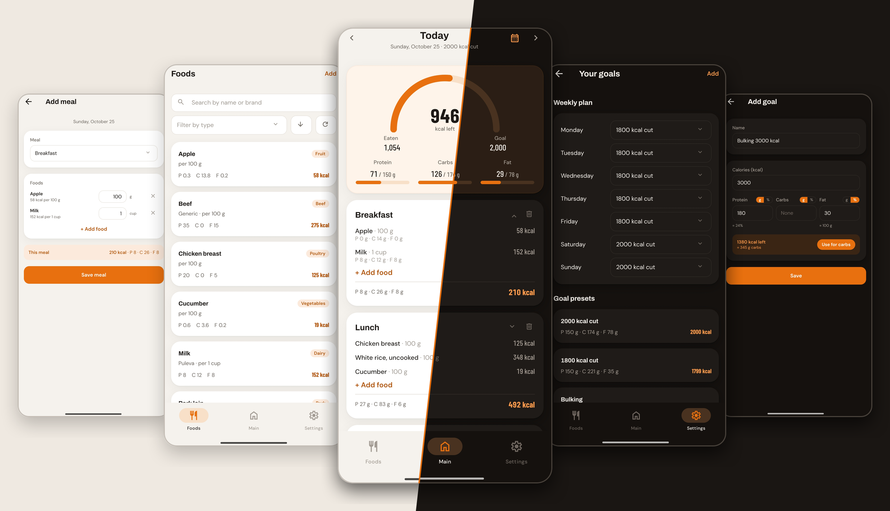

# Bitebook – Macro Diary

An Android app for logging what you eat and comparing each day's calories, protein, carbs and fat against a goal. Goals can change by weekday, past days keep the goal they had, and everything is stored on the device, without an account or a server.

Built with Expo (React Native) and TypeScript, using SQLite for storage. Available in English and Spanish, with light and dark themes.



<p align="center">
  
</p>

## What it does

- **Daily log:** meals made of foods, with the day's totals on a calorie gauge and macro bars that turn red when over the goal.
- **Food library:** foods saved once per reference amount (100 g, a slice, a cup…) and reused. Searchable, filterable by type and sortable.
- **Barcode scanning:** scan a package to fill in a food from [Open Food Facts](https://world.openfoodfacts.org). Scanning a product that's already saved lists its versions (per 100 g, per serving…).
- **Goals by weekday:** optional macro targets in grams or as a percentage of calories.
- **Correct history:** editing a goal or a food never changes days that were already logged.
- **Any day:** browse past days or plan future ones with arrows or a calendar.
- **Backup:** export all data to a JSON file and import it on another phone.
- **English and Spanish**, and **light and dark themes**, chosen in Settings.

## How it's built

- **Versioned SQLite migrations** ([`migrations.ts`](src/db/migrations.ts)). Logged meals and days keep their own copy of food and goal values, so history never changes; goal edits apply to today and future days inside a transaction ([`goals.ts`](src/db/goals.ts)).
- **Import is checked before anything changes** and runs in one transaction. Only the table's real columns are inserted, so nothing from the file reaches the SQL ([`backup.ts`](src/db/backup.ts)).
- **Typed translations:** the Spanish texts are typed against the English ones, so a missing text is a compile error ([`en.ts`](src/i18n/en.ts)).
- **Theme-aware styles** through a `useStyles` hook, so the whole app switches theme in a single render ([`use-theme.tsx`](src/hooks/use-theme.tsx)).
- **Automated tests** with Jest (`npm test`). The real database code runs against an in-memory SQLite through a small stand-in for expo-sqlite ([`test-db.ts`](src/db/test-db.ts)), and barcode lookups are tested with saved Open Food Facts answers instead of the internet.
- **Barcode lookup kept separate from the screen** ([`open-food-facts.ts`](src/utils/open-food-facts.ts)): it turns Open Food Facts' categories into the app's food types with an ordered list of rules, and tells "not found" apart from "no internet".

[SPEC.md](SPEC.md) lists the features and decisions of each version, and [DATABASE.md](DATABASE.md) describes every table.

## Stack

- [Expo](https://expo.dev) SDK 58, React Native 0.88, React 19 with the React Compiler
- TypeScript
- Expo Router (file-based routes, native bottom tabs)
- expo-sqlite (database, plus its key-value store for settings)
- React Native Reanimated, react-native-svg
- expo-camera (barcode scanning) and the Open Food Facts API
- Jest with jest-expo
- EAS Build for Android builds

## Running it

Requirements: Node.js and the Expo Go app on an Android phone.

```bash
npm install
npx expo start
```

Scan the QR code with Expo Go. To run the tests:

```bash
npm test
```

To build an installable APK with EAS:

```bash
npx eas-cli@latest build --platform android --profile preview
```

## Status and next steps

Versions 1.0 and 1.1 (barcode scanning and automated tests) are done. The app has been tested on Android only. It also targets iOS, but hasn't been run there.

Ideas for later (see [SPEC.md](SPEC.md)):

- Weekly charts and stats
- Reusable meals with preset foods

## License

[MIT](LICENSE)
